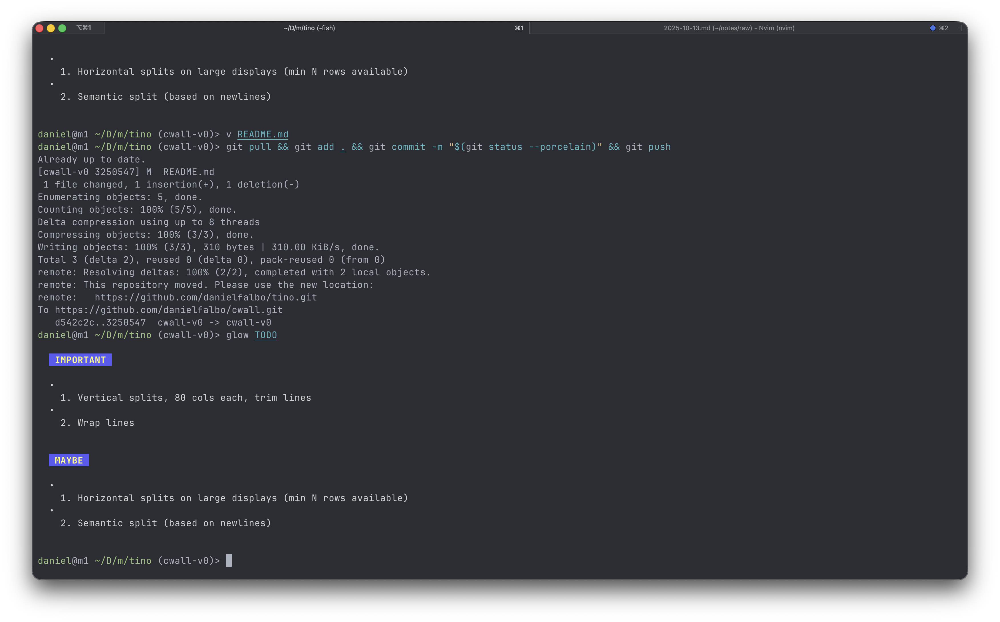

[🛠️ WIP] Tino
===

Tino is a very simple text visualization utility that lays out the
given file in enough splits to be visualized from start to finish in
the current terminal window, if possible. Like laying out every page
of a screenplay on a wall.

Usage: tino `<filename>`

Tino does not depend on any library.

Tino was bootstrapped using Salvatore Sanfilippo aka antirez's
[Kilo](https://github.com/antirez/kilo) as a template.

Tino was written by Daniel Falbo, and is released under the BSD 2 clause license.
